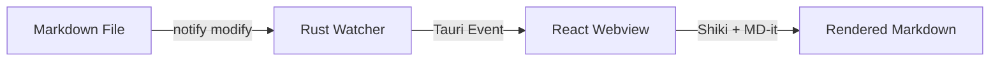

# Architecture Overview

This document describes the high-level architecture of **mdview**.

## Subsystems

### 1. Tauri Backend (Rust)
- **CLI Parser (`cli.rs`)**: Inspects command line arguments, handles relative vs canonical paths.
- **File System (`fs_service.rs`)**: Reads markdown files and builds folder trees.
- **Watcher (`watcher.rs`)**: Uses the `notify` crate to watch active markdown files on disk.

### 2. Frontend Pipeline (React 19 + Shiki)
- **markdown-it**: Fast AST conversion with GFM tables and task lists.
- **shiki**: High-fidelity code highlighting with VS Code themes.
- **IntersectionObserver**: Zero-jank TOC scrollspy.

